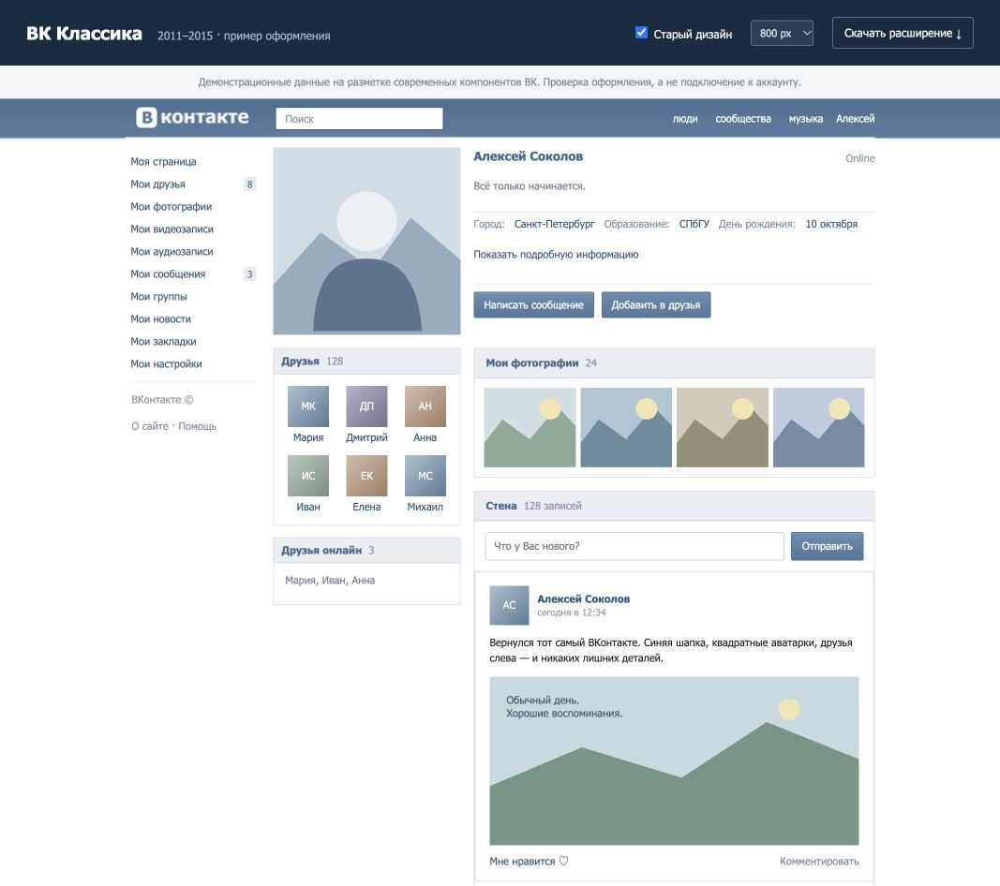

# ВК Классика · 2011–2015

Расширение для Chrome, которое оформляет нынешний ВКонтакте в стиле 2011–2015 годов: архивный логотип, синий верх, Tahoma / 11 px, квадратные аватарки, текстовое меню «Моя страница / Мои друзья» и профиль с фотографией и друзьями слева.



**Скриншот — локальная демонстрация с вымышленными данными.** Это стилизация современного сайта; удалённые функции старого ВК она не восстанавливает. Проверка на авторизованном аккаунте пока не выполнена.

## Установка

1. Скачай [готовый ZIP](VK-Classic-2011-2015.zip) и распакуй.
2. Открой `chrome://extensions` и включи **Режим разработчика**.
3. Нажми **Загрузить распакованное расширение** и выбери папку **vk-classic** с `manifest.json`.
4. Обнови вкладку `vk.ru` или `vk.com`.

Если уже установлена версия 1.0.0, замени файлы в подключённой папке, нажми кнопку обновления на карточке расширения, затем обнови ВК. Нажми **Вернуть настройки** в расширении, чтобы получить новые исходные 800 px / 11 px.

Подробности и настройки: [инструкция](vk-classic/README.md).

## Как работает

Manifest V3. Стили и небольшой адаптер действующих компонентов VKCOM Kit меняют вид нативных элементов. Ссылки, счётчики, кнопки, обработчики ВК и данные страницы сохраняются. Поддерживаются `vk.ru`, `vk.com` и их `www`-варианты.

Единственное явно запрошенное разрешение — `storage` для локальных настроек. Расширение не использует удалённый код, аналитику, серверы, cookies или запросы к сторонним сервисам. Выключение снимает оформление без перезагрузки.

## Разработка и проверка

Для самого расширения сборка и зависимости не нужны. Для проверок нужен Node.js 22+ и Python 3:

```sh
npm ci
npm test
npm run pack
```

13 проверок покрывают настройки, выключение, изменение меню после загрузки, новые компоненты профиля, сохранность нативных действий и восстановление разметки. Локальный пример повторяет структуру текущих компонентов, но не заменяет проверку внутри настоящего аккаунта.

Для просмотра примера:

```sh
python3 -m http.server 8765 --bind 127.0.0.1
```

Открой `http://127.0.0.1:8765/preview/` и переключи «Старый дизайн» для сравнения.

## Источники оформления

[OldVK](https://github.com/Kesantielu/oldvk), включая предоставленный пользователем исходник 61.0, послужил источником архивного GIF логотипа и образцом Tahoma / 11 px. [OldVK_Gold](https://github.com/BogdanSochivko/OldVK_Gold) — дополнительный визуальный ориентир. Современный адаптер написан отдельно; код этих расширений не включён. Логотип ВКонтакте относится к соответствующему бренду.

Неофициальный проект, не связанный с администрацией ВКонтакте.
