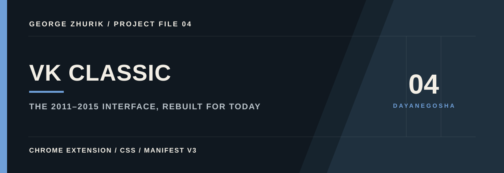
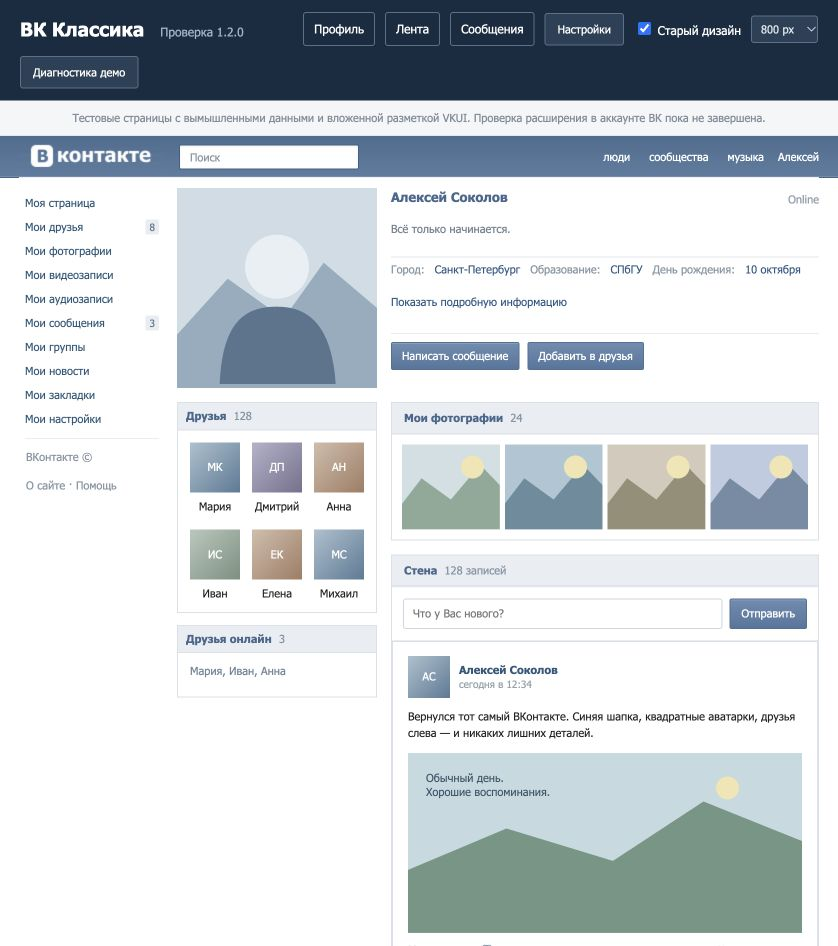

<p align="center"></p>

# ВК Классика · 2011–2015

Расширение для Chrome, которое оформляет нынешний ВКонтакте в стиле 2011–2015 годов: архивный логотип, синий верх, Tahoma / 11 px, квадратные аватарки, текстовое меню «Моя страница / Мои друзья» и профиль с фотографией и друзьями слева.



## Установка

1. Скачай [готовый ZIP](VK-Classic-2011-2015.zip) и распакуй.
2. Открой `chrome://extensions` и включи **Режим разработчика**.
3. Нажми **Загрузить распакованное расширение** и выбери папку **vk-classic** с `manifest.json`.
4. Обнови вкладку `vk.ru` или `vk.com`.

Если расширение уже установлено, замени файлы в подключённой папке, нажми кнопку обновления на карточке расширения, затем обнови ВК. Нажми **Вернуть настройки** в расширении, чтобы получить новые исходные 800 px / 11 px.

Подробности и настройки: [инструкция](vk-classic/README.md).

## Обновление 1.2.0

Исправлены ограничения вложенных колонок профиля и размещение друзей. Переключатели историй и правой панели учитывают нынешние контейнеры ленты. Для сообщений и ленты с правой панелью ширина автоматически увеличивается до 1040 px; выбранная компактная ширина сохраняется для профиля. Светлые цвета применяются к компонентам VKUI, включая страницы с тёмной внутренней темой. Неудачный логотип из окна настроек удалён; архивный логотип остаётся в шапке ВК.

## Как работает

Manifest V3. Стили и небольшой адаптер действующих компонентов VKCOM Kit меняют вид нативных элементов. Ссылки, счётчики, кнопки, обработчики ВК и данные страницы сохраняются. Поддерживаются `vk.ru`, `vk.com` и их `www`-варианты.

Единственное явно запрошенное разрешение — `storage` для локальных настроек. Расширение не использует удалённый код, аналитику, серверы, cookies или запросы к сторонним сервисам. Выключение снимает оформление без перезагрузки.

## Статус и ограничения

Скриншот выше — локальная демонстрация с вымышленными данными. Расширение
стилизует современный сайт, но не восстанавливает удалённые функции старого ВК.
Автоматические проверки и локальные тестовые страницы пройдены; проверка на
авторизованном аккаунте пока не завершена.

Для проверки на настоящем ВК открой профиль, ленту и сообщения, затем выбери в
расширении **Сохранить диагностику страницы**. Файл содержит структуру
компонентов, настройки, размеры и цвета до и после оформления. Текст,
фотографии, ссылки, адрес страницы, содержимое форм и динамические
идентификаторы в него не попадают. Диагностика остаётся на компьютере и не
отправляется автоматически.

## Разработка и проверка

Для самого расширения сборка и зависимости не нужны. Для проверок нужен Node.js 22+ и Python 3:

```sh
npm ci
npm test
npm run pack
```

21 проверка покрывает настройки, выключение, динамическое меню, вложенные колонки профиля, сетку друзей, истории, правую панель ленты и диагностику без содержимого страницы. Локальный пример повторяет структуру текущих компонентов, но не заменяет проверку внутри настоящего аккаунта.

Для просмотра примера:

```sh
python3 tools/preview_server.py
```

Открой `http://127.0.0.1:8765/preview/`. В верхней панели доступны профиль, лента, сообщения и настоящее окно настроек расширения с локальным хранилищем вместо Chrome API. Переключи «Старый дизайн» для сравнения.

## Источники оформления

[OldVK](https://github.com/Kesantielu/oldvk), включая предоставленный пользователем исходник 61.0, послужил источником архивного GIF логотипа и образцом Tahoma / 11 px. [OldVK_Gold](https://github.com/BogdanSochivko/OldVK_Gold) — дополнительный визуальный ориентир. Современный адаптер написан отдельно; код этих расширений не включён. Логотип ВКонтакте относится к соответствующему бренду.

Неофициальный проект, не связанный с администрацией ВКонтакте.
